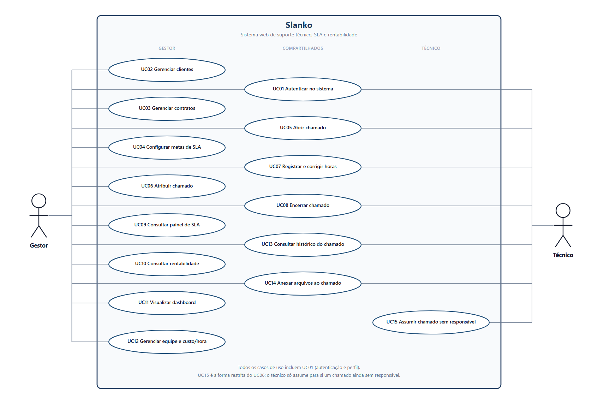
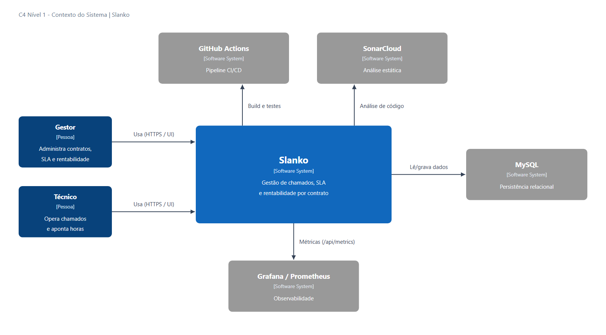
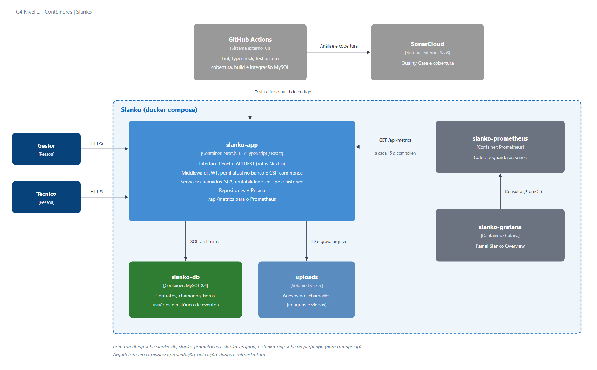
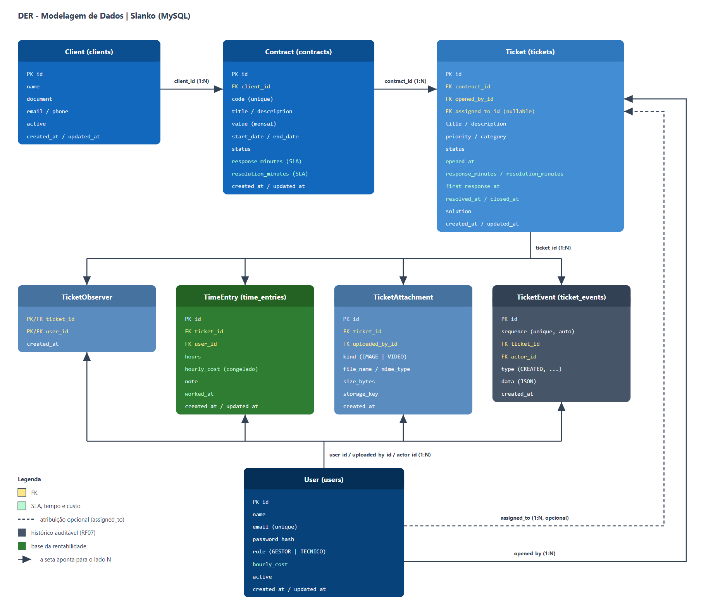
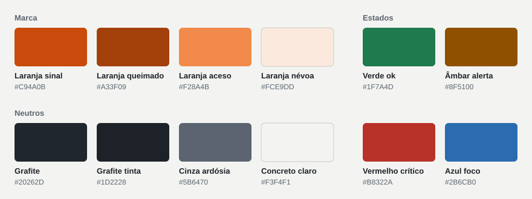

# Slanko

**Nome do Estudante:** Miguel Ricardo Buttendorf  
**Curso:** Engenharia de Software  
**Instituição:** Centro Universitário Católica de Santa Catarina  
**Linha de projeto:** Web Apps  

[](https://github.com/MiguelRBTT/slanko/actions/workflows/ci.yml)
[](https://sonarcloud.io/summary/new_code?id=MiguelRBTT_slanko)

Sistema web para gestão de contratos de suporte técnico com análise de SLA e rentabilidade.

---

## Navegação

* [Descrição](#descrição)
* [Trabalhos relacionados](#trabalhos-relacionados)
* [Documentação](#documentação)
* [Especificação técnica](#especificação-técnica)
* [Arquitetura](#arquitetura)
* [Diagramas](#diagramas)
* [Modelagem de dados](#modelagem-de-dados)
* [Identidade visual](#identidade-visual)
* [Status de implementação](#status-de-implementação)
* [Instruções de execução](#instruções-de-execução)
* [Próximos passos](#próximos-passos)
* [Referências](#referências)

---

## Descrição

O **Slanko** é um sistema web voltado a microempresas de TI que prestam suporte técnico. A plataforma centraliza chamados, contratos, apontamento de horas, acompanhamento de SLA e indicadores de rentabilidade.

O nome remete a SLA de forma memorável. No repositório e no código, o projeto é referenciado como `slanko`.

### Contexto

Muitas microempresas acompanham chamados e prazos em planilhas ou ferramentas isoladas. Fica difícil cruzar o esforço real (horas) com o valor contratado e identificar contratos deficitários.

### Justificativa

Ferramentas de helpdesk cobrem tickets e SLA, mas raramente consolidam custo por hora e margem por contrato de forma simples para microempresas. O Slanko une operação e indicadores de rentabilidade, sem se tornar ERP ou sistema financeiro genérico.

### Objetivos

Entregar uma aplicação web funcional com três fluxos de negócio completos:

1. **Gestão de chamados** (clientes, contratos, abertura, atribuição, horas e encerramento)
2. **Monitoramento de SLA** (metas por contrato, cumprimento, violações e painel)
3. **Análise de rentabilidade** (horas × custo/hora versus valor do contrato, margem e alertas)

### Motivação

Projeto acadêmico da linha Web Apps (PAC VII / Portfólio), com arquitetura cliente-servidor em camadas, testes, CI/CD e documentação técnica.

---

## Trabalhos relacionados

Baseados no relatório do PAC 7B:

* Rachmawati e Suhendra (2018): helpdesk web com tickets
* Clarin (2023): priorização/escalonamento de atendimentos
* Jain, Gupta e Neha (2024): otimização de filas de suporte com IA (foco operacional)
* Zendesk e Jira Service Management: SLA e operação maduros
* Freshservice: contratos, sem consolidar nativamente custo/hora e margem por contrato

A lacuna comum é a baixa integração entre operação e rentabilidade por horas trabalhadas. Detalhes e referências completas: [docs/RFC.md](docs/RFC.md).

---

## Documentação

### Documentos do projeto

| Documento | Conteúdo |
|---|---|
| [docs/RFC.md](docs/RFC.md) | Escopo, RF/RNF, critérios de aceite, stack e decisões |
| [docs/casos-de-uso.md](docs/casos-de-uso.md) | Atores, UC01–UC11 e rastreabilidade |
| [docs/arquitetura-c4.md](docs/arquitetura-c4.md) | C4 (contexto, contêineres e componentes) |
| [docs/modelagem.md](docs/modelagem.md) | DER, dicionário de dados, regras e esboço Prisma |

A documentação oficial permanece no repositório e na [Wiki do GitHub](https://github.com/MiguelRBTT/slanko/wiki) (não em Notion/Obsidian para entrega). Fonte das páginas da Wiki: [`docs/wiki/`](docs/wiki/).

### Estrutura atual do repositório

```text
slanko/
├── src/
│   ├── app/                    # Next.js pages and API routes
│   ├── components/             # UI (dashboard in later iterations)
│   ├── lib/                    # prisma client, http helpers, errors
│   ├── repositories/           # data access (Prisma)
│   ├── services/               # business rules
│   └── types/                  # shared DTOs
├── tests/                      # Vitest unit and API route tests
├── prisma/                     # schema, migrations, seed
├── docs/
│   ├── RFC.md, casos-de-uso.md, arquitetura-c4.md, modelagem.md
│   └── wiki/                   # fonte das páginas da Wiki do GitHub
├── scripts/
│   └── publish-wiki.ps1        # publica docs/wiki no GitHub Wiki
├── docker-compose.yml          # MySQL local (slanko-db)
├── package.json
└── vitest.config.ts
```

### Versionamento

Commits em inglês, no padrão Conventional Commits:

* `feat:` new feature
* `fix:` bug fix
* `docs:` documentation only
* `test:` tests
* `chore:` tooling, config, or maintenance
* `refactor:` code change without new feature or fix

Exemplos:

* `docs: add RFC, use cases, C4 and data model`
* `feat: add contract registration API`
* `fix: correct SLA response time calculation`

---

## Especificação técnica

### Requisitos funcionais (resumo)

```text
RF01: Autenticação JWT e perfis (gestor e técnico)
RF02: Cadastro de clientes
RF03: Cadastro de contratos vinculados a clientes
RF04: Abertura de chamados com prioridade e categoria
RF05: Atribuição de chamado a técnico
RF06: Apontamento de horas (gestor ou técnico)
RF07: Encerramento de chamado com solução e histórico
RF08: Metas de SLA por contrato
RF09: Cálculo de cumprimento de SLA
RF10: Painel e sinalização de violações de SLA
RF11: Cálculo de custo operacional (horas × custo/hora)
RF12: Indicadores de margem/rentabilidade por contrato
RF13: Alertas para contratos deficitários ou com SLA crítico
RF14: Dashboard consolidado
```

### Requisitos não funcionais (resumo)

```text
RNF01: Interface responsiva com feedback ao usuário
RNF02: Arquitetura cliente-servidor em camadas
RNF03: Persistência MySQL (sem SQLite/H2)
RNF04: TDD com cobertura mínima 75% backend / 25% frontend
RNF05: CI/CD com GitHub Actions
RNF06: Análise estática (SonarCloud)
RNF07: Observabilidade (Grafana e/ou Prometheus)
RNF08: Segurança (validação, XSS/CSRF, senhas criptografadas)
RNF09: Código modular sob o identificador slanko
RNF10: Documentação no repositório/Wiki
```

Detalhamento e critérios de aceite: [docs/RFC.md](docs/RFC.md).

### Stack tecnológica

| Camada | Tecnologia |
|---|---|
| Full-stack | TypeScript, Next.js, React |
| Dados | MySQL, Prisma |
| Testes | Jest e/ou Vitest (TDD) |
| Infra | Docker (`slanko-app`, `slanko-db`) |
| CI/CD | GitHub Actions |
| Qualidade | SonarCloud |
| Observabilidade | Grafana e/ou Prometheus |

### Segurança

* Autenticação JWT (Bearer) e autorização por perfil (gestor / técnico), checada no middleware e de novo em cada rota de gestor
* A cada requisição o middleware confere no banco se o usuário segue ativo e qual é o perfil atual: desativar alguém corta o acesso na hora, sem esperar o token expirar
* Cabeçalhos `x-user-*` enviados pelo cliente são descartados; só o middleware define a identidade
* Senhas com bcrypt; login limitado a 5 falhas por email a cada 15 min (HTTP 429 com `Retry-After`). O IP só entra na chave atrás de um proxy confiável (`TRUST_PROXY=true`), porque `X-Forwarded-For` pode ser forjado
* `/api/metrics` exige `Authorization: Bearer <METRICS_TOKEN>` (expõe indicadores financeiros); o Prometheus local já envia o token de desenvolvimento
* CSP com nonce por requisição (só os scripts do próprio Next.js executam), `nosniff`, `X-Frame-Options: DENY`, `Referrer-Policy`, `Permissions-Policy` e HSTS em produção
* CSRF: não se aplica ao modelo atual, porque o token vai no cabeçalho `Authorization` (não em cookie) e o navegador não o envia sozinho em requisições de outros sites
* Validação de entradas em todas as rotas (JSON malformado e tipos errados viram 400, não 500); anexos conferidos pelos bytes iniciais do arquivo, não só pelo tipo declarado
* Técnico não recebe custo/hora de colegas nem valor de contratos
* HTTPS no desenvolvimento local (`npm run dev`)
* Segredos apenas em variáveis de ambiente

---

## Arquitetura

Arquitetura adotada: **cliente-servidor em camadas**.

```text
Apresentação     → Next.js / React / TypeScript
Aplicação        → rotas/API, validação, regras de SLA e rentabilidade
Dados            → Prisma + repositories
Persistência     → MySQL (slanko-db)
Infraestrutura   → Docker, GitHub Actions, SonarCloud, monitoramento
```

Organização de código prevista:

* `components/` interface
* `services/` regras de negócio
* `repositories/` acesso a dados
* `tests/` testes automatizados

Documentação completa: [docs/arquitetura-c4.md](docs/arquitetura-c4.md).

### Metodologia

Desenvolvimento iterativo com Kanban, commits frequentes e entregas modulares. Gestão de tarefas: GitHub Projects (ou equivalente do playbook).

### Registro de decisões

* [RFC: Proposta Slanko](docs/RFC.md)

---

## Diagramas

### Casos de uso



Atores: **Gestor** e **Técnico** (UC01 a UC11).  
Detalhamento: [docs/casos-de-uso.md](docs/casos-de-uso.md).

### C4 - Contexto (nível 1)



### C4 - Contêineres (nível 2)



Detalhamento: [docs/arquitetura-c4.md](docs/arquitetura-c4.md).

### Fluxo de negócio (resumo)

1. Gestor cadastra clientes e contratos (valor e metas de SLA)
2. Gestor e técnico registram chamados e apontam o tempo de trabalho, em minutos, na tela de chamados
3. O sistema calcula cumprimento de SLA e violações
4. O sistema calcula custo operacional e margem por contrato
5. O gestor vê indicadores e alertas no painel

---

## Modelagem de dados



Entidades: **User**, **Client**, **Contract**, **Ticket**, **TimeEntry**.

* SLA: metas no contrato (`response_minutes`, `resolution_minutes`). O relógio começa na abertura; a 1ª resposta é o início do atendimento (sair de "Aberto" ou o 1º apontamento), não a atribuição. Chamado sem resposta/resolução com prazo vencido já conta como violação
* Rentabilidade: `TimeEntry.hours × TimeEntry.hourly_cost` (custo/hora congelado no apontamento) comparado à receita do período (`Contract.value` é **mensal**, proporcional aos dias de vigência)
* Histórico: cada alteração do chamado gera um `TicketEvent` (RF07)

Dicionário de dados, regras e esboço Prisma: [docs/modelagem.md](docs/modelagem.md).

---

## Identidade visual

A interface usa poucos elementos e cores com função: o **laranja é sinal**, não decoração. Ele aparece na ação principal de cada tela, no item ativo do menu e nos alertas de prazo; o resto da interface é grafite e neutros. Os tokens ficam em [`src/app/globals.css`](src/app/globals.css).



### Paleta de cores

| Cor | Hex | Token CSS | Uso |
|---|---|---|---|
| Laranja sinal | `#C94A0B` | `--brand` | Botão de ação principal (texto branco com contraste 4,7:1) |
| Laranja queimado | `#A33F09` | `--brand-hover` | Hover do botão principal, texto laranja sobre fundo claro, prazo de SLA perto de estourar |
| Laranja aceso | `#F28A4B` | `--brand-bright` | Marcador do item ativo no menu (sobre o grafite) |
| Laranja névoa | `#FCE9DD` | `--brand-soft` | Fundo de destaque suave (linha selecionada, seleção de texto) |
| Grafite | `#20262D` | `--graphite` | Barra lateral e painel da tela de login |
| Grafite tinta | `#1D2228` | `--ink` | Texto principal |
| Cinza ardósia | `#5B6470` | `--ink-muted` | Texto secundário e rótulos |
| Cinza névoa | `#8A929C` | `--ink-subtle` | Placeholders e ícones inativos |
| Concreto claro | `#F3F4F1` | `--paper` | Fundo da aplicação |
| Branco | `#FFFFFF` | `--surface-raised` | Painéis, tabelas e formulários |
| Linha | `#DCDFDA` / `#C7CBC5` | `--line` / `--line-strong` | Divisórias / bordas de campos e cabeçalhos de tabela |
| Verde ok | `#1F7A4D` sobre `#E3F1E8` | `--ok` / `--ok-soft` | Resolvido, dentro do prazo, ativo |
| Âmbar alerta | `#8F5100` sobre `#F8EBD3` | `--warn` / `--warn-soft` | Em andamento, aguardando, prioridade alta, suspenso |
| Vermelho crítico | `#B8322A` sobre `#F9E2DF` | `--danger` / `--danger-soft` | Prazo violado, prioridade crítica, prejuízo, erros |
| Azul foco | `#2B6CB0` | `--focus` | Anel de foco do teclado (fora da paleta da marca de propósito, para nunca se confundir com alerta) |

Todas as combinações de texto passam no contraste mínimo do WCAG AA (4,5:1). Antes, o laranja `#EA580C` com texto branco tinha 3,56:1.

### Tipografia

* **Archivo** (variável, carregada pelo `next/font`): uma família só, com a largura semi-expandida nos títulos e expandida no nome da marca. O peso e a largura vêm de um único arquivo de fonte.
* Texto em peso 400; rótulos e ênfases em 600; títulos em 650.
* Algarismos tabulares (`font-variant-numeric: tabular-nums`) em tabelas, indicadores e prazos, para que valores, horas e percentuais fiquem alinhados. Colunas numéricas são alinhadas à direita.

### Princípios

* **Uma ousadia só:** a frase grande em fonte expandida no painel grafite do login. O resto é contido.
* **Chamados em cartões:** cada cartão é uma prévia (situação, prazo de SLA, título, contrato, prioridade, responsável e tempo); as ações ficam no painel de detalhe, que abre ao clicar no cartão.
* **Separação por borda:** painéis usam só borda. Sombra fica para o que flutua (diálogos e bolhas de ajuda).
* **Raio por função:** 6px em controles e badges, 10px em painéis e 14px em diálogos.
* **Cor com significado:** badges suaves com um ponto de cor; vermelho só para o que pede ação imediata.
* **Rótulos em caixa normal**, sem caixa alta, e foco do teclado sempre visível.
* **Movimento só como resposta a uma ação** (abrir, trocar de aba, passar o mouse) e desligado para quem pede `prefers-reduced-motion`.

---

## Status de implementação

| Área | Status |
|---|---|
| Documentação (RFC, UC, C4, modelagem) | Concluída (fase de planejamento) |
| Banco MySQL + Prisma + Docker | Concluído (schema, migrate, seed) |
| Back-end (Next.js API + services) | Concluído (clientes, contratos, chamados, horas, SLA e rentabilidade) |
| Front-end (UI / dashboard) | Concluído (login, painel SLA/rentabilidade, clientes, contratos e chamados) |
| Testes (TDD 75% / 25%) | Concluído (Vitest: ≥75% backend + ≥25% frontend no CI) |
| CI/CD (GitHub Actions) | CI concluído (lint, typecheck, test:coverage, build, SonarCloud e integração com MySQL); deploy não automatizado (apresentação local) |
| SonarCloud | Concluído (scan no CI + Quality Gate; secret `SONAR_TOKEN`) |
| Observabilidade | Concluído (Prometheus + Grafana + `/api/metrics`) |
| Wiki do GitHub | Concluído (páginas em `docs/wiki/` + Wiki no GitHub) |

---

## Instruções de execução

### Pré-requisitos

* Node.js 22.12+ (versão em `.nvmrc`; o Vite 7 usado pelos testes não roda no 22.11 ou anterior)
* [Docker Desktop](https://www.docker.com/products/docker-desktop/) (Windows)
* Git

### Setup local (banco de dados)

1. Clone o repositório e entre na pasta do projeto.
2. Copie o arquivo de ambiente:
   ```bash
   cp .env.example .env
   ```
   No Windows (PowerShell): `Copy-Item .env.example .env`
3. Instale as dependências:
   ```bash
   npm install
   ```
4. Suba o MySQL no Docker:
   ```bash
   npm run db:up
   ```
   Aguarde o container `slanko-db` ficar saudável (`docker ps`).
5. Crie as tabelas no banco:
   ```bash
   npm run db:migrate
   ```
   Na primeira execução, confirme o nome da migração (ex.: `init`).
6. (Opcional) Popule dados de exemplo:
   ```bash
   npm run db:seed
   ```
7. (Opcional) Abra uma interface visual do banco:
   ```bash
   npm run db:studio
   ```

**Usuários de teste (seed):** senha `Slanko@123`.

| E-mail | Perfil | O que vê na interface |
|---|---|---|
| `gestor@slanko.local` | Gestor | Painel, clientes, contratos, chamados e equipe |
| `tecnico@slanko.local` | Técnico | Somente chamados (responsável no seed) |
| `tecnico2@slanko.local` | Técnico | Somente chamados (observador no seed) |

**Scripts úteis:** `npm run db:down` (para o MySQL), `npm run db:logs` (logs do container), `npm run db:reset` (apaga e recria tudo — cuidado).

### Aplicação (Next.js)

```bash
npm run dev
```

Abra [https://localhost:3000](https://localhost:3000). A home redireciona para `/login`. Depois do login, o gestor entra em `/dashboard` e o técnico em `/tickets`.

**HTTPS local:** `npm run dev` usa `next dev --experimental-https`. Na primeira execução, o Next.js baixa o [mkcert](https://github.com/FiloSottile/mkcert), cria uma autoridade certificadora local e pede para instalá-la no Windows. Aceite a confirmação: é ela que faz o navegador confiar no certificado de `localhost`. Os certificados ficam em `certificates/` (fora do git). Para rodar sem HTTPS: `npm run dev:http` (http://localhost:3000).

**App em container (opcional):** `npm run app:up` faz o build da imagem `slanko-app` (Dockerfile) e sobe em http://localhost:3002, aplicando as migrations pendentes antes de iniciar. Usa o `JWT_SECRET` do `.env`. `npm run app:down` para.

**Interface web:**

O menu do técnico tem apenas **Chamados**. Painel, clientes, contratos e equipe são telas do gestor. Se o técnico abrir `/dashboard`, `/clients`, `/contracts` ou `/users`, a aplicação devolve para `/tickets`.

* `/login` — autenticação JWT
* `/dashboard` — painel de SLA e rentabilidade (somente gestor)
* `/clients` — clientes (somente gestor)
* `/contracts` — contratos (somente gestor). O valor informado é a mensalidade do contrato
* `/users` — equipe (somente gestor): cadastro de pessoas, perfil, custo por hora, desativação e redefinição de senha
* `/tickets` — chamados. O gestor vê todos. O técnico vê os em que é responsável ou observador, e também os que abriu enquanto estiverem sem responsável. Quem tem acesso ao chamado pode apontar minutos, resolver, corrigir dados, encerrar e anexar imagens/vídeos. Só o gestor define responsável e observadores; o técnico pode assumir um chamado sem responsável. Quem apontou (ou o gestor) corrige ou exclui o próprio apontamento enquanto o chamado não está encerrado, e a correção fica no histórico. Anexos: imagem até 5 MB, vídeo até 50 MB, no máximo 10 por chamado. Todo chamado, inclusive encerrado, tem o botão **Histórico** com as alterações registradas. Só é possível excluir chamados abertos por engano (sem tempo apontado e ainda não resolvidos).

**Autenticação (JWT):**

```bash
# Login
curl -k -X POST https://localhost:3000/api/auth/login \
  -H "Content-Type: application/json" \
  -d "{\"email\":\"gestor@slanko.local\",\"password\":\"Slanko@123\"}"

# Rotas protegidas (use o token retornado)
curl -k https://localhost:3000/api/users -H "Authorization: Bearer SEU_TOKEN"
curl -k https://localhost:3000/api/clients -H "Authorization: Bearer SEU_TOKEN"
```

Endpoints:

| Rota | Auth | Perfil |
|------|------|--------|
| `GET /api/health` | Pública | — |
| `GET /api/metrics` | Pública | — (Prometheus) |
| `POST /api/auth/login` | Pública | — (429 após 5 falhas em 15 min) |
| `GET /api/users` | JWT | gestor ou técnico (`includeInactive=true`: gestor) |
| `POST /api/users` | JWT | gestor only |
| `GET /api/users/:id` | JWT | gestor ou técnico |
| `PUT /api/users/:id` | JWT | gestor only |
| `GET /api/clients` | JWT | gestor only |
| `POST /api/clients` | JWT | gestor only |
| `GET /api/clients/:id` | JWT | gestor only |
| `PUT /api/clients/:id` | JWT | gestor only |
| `DELETE /api/clients/:id` | JWT | gestor only (soft delete) |
| `GET /api/contracts` | JWT | gestor ou técnico |
| `POST /api/contracts` | JWT | gestor only |
| `GET /api/contracts/:id` | JWT | gestor ou técnico |
| `PUT /api/contracts/:id` | JWT | gestor only |
| `DELETE /api/contracts/:id` | JWT | gestor only |
| `GET /api/tickets` | JWT | gestor ou técnico |
| `POST /api/tickets` | JWT | gestor ou técnico |
| `GET /api/tickets/:id` | JWT | gestor ou técnico |
| `PUT /api/tickets/:id` | JWT | gestor ou técnico |
| `DELETE /api/tickets/:id` | JWT | gestor ou técnico (só sem tempo apontado e não resolvido) |
| `GET /api/tickets/:id/events` | JWT | gestor ou técnico |
| `GET /api/tickets/:id/time-entries` | JWT | gestor ou técnico |
| `POST /api/tickets/:id/time-entries` | JWT | gestor ou técnico |
| `PUT /api/tickets/:id/time-entries/:entryId` | JWT | autor do apontamento ou gestor |
| `DELETE /api/tickets/:id/time-entries/:entryId` | JWT | autor do apontamento ou gestor |
| `GET /api/tickets/:id/attachments` | JWT | gestor ou técnico |
| `POST /api/tickets/:id/attachments` | JWT | gestor ou técnico (multipart `file`) |
| `DELETE /api/tickets/:id/attachments/:attachmentId` | JWT | gestor ou técnico |
| `GET /api/tickets/:id/attachments/:attachmentId/file` | JWT | gestor ou técnico |
| `GET /api/sla/summary` | JWT | gestor only |
| `GET /api/sla/contracts/:id` | JWT | gestor only |
| `GET /api/profitability/summary` | JWT | gestor only |
| `GET /api/profitability/contracts/:id` | JWT | gestor only |

Filtros úteis: `GET /api/sla/summary` aceita `clientId`, `contractId`, `startDate`, `endDate` (YYYY-MM-DD) e `status` (`ACTIVE` padrão, `SUSPENDED`, `FINISHED` ou `ALL`; rascunhos nunca entram). O painel tem o mesmo filtro de situação. O relatório por contrato aceita `startDate` e `endDate`. Os endpoints de rentabilidade usam os mesmos filtros de período: o custo considera o `workedAt` das horas apontadas e a receita é o valor mensal proporcional aos dias de vigência dentro do período (limitado a hoje).

### Testes

```bash
npm test
npm run test:watch
npm run test:coverage
npm run test:coverage:backend
npm run test:coverage:frontend
npm run test:integration
npm run typecheck
```

`test:coverage` (RNF04) roda as duas metas:

* **Backend ≥ 75%** — `vitest.config.ts` + `coverage/` (LCOV usado pelo SonarCloud)
* **Frontend ≥ 25%** — `vitest.frontend.config.ts` + `coverage-frontend/`

Escopos em `vitest.coverage.ts`. Testes de UI em `tests/frontend/` (jsdom + Testing Library).

**Integração (MySQL real):** `npm run test:integration` roda `tests/integration/` sem mocks (services → repositories → Prisma → MySQL): histórico atômico, custo/hora congelado, SLA, receita proporcional e revogação de acesso. Usa o banco `slanko_test` no MySQL do Docker (`TEST_DATABASE_URL` sobrescreve) e aplica as migrations antes. Por segurança, só roda em bancos cujo nome termina em `_test`, então o banco de desenvolvimento nunca é tocado.

**Typecheck:** `npm run typecheck` checa o projeto inteiro, inclusive os testes (o `next build` só checa `src/`).

### CI (GitHub Actions)

O workflow `.github/workflows/ci.yml` roda em todo push/PR para `main`:

Job `build-and-test` (Node da versão em `.nvmrc`):

1. `npm ci`
2. `npx prisma validate`
3. `npm run lint`
4. `npm run typecheck` (inclui os testes)
5. `npm run test:coverage` (backend ≥75% + frontend ≥25%; LCOV backend em `coverage/lcov.info`)
6. `npm run build`
7. SonarCloud Scan (quando o secret `SONAR_TOKEN` estiver configurado)

Job `integration`: sobe um MySQL 8.4 como serviço e roda `npm run test:integration`.

### SonarCloud (RNF06)

Análise estática via [SonarCloud](https://sonarcloud.io) no CI, com Quality Gate (`sonar.qualitygate.wait=true`) e cobertura LCOV do Vitest.

Arquivos:

* `sonar-project.properties` — chave do projeto, organização, exclusões e caminho do LCOV
* `.github/workflows/ci.yml` — passo `SonarCloud Scan`

Setup (uma vez):

1. Crie uma conta em [sonarcloud.io](https://sonarcloud.io) e importe o repositório `MiguelRBTT/slanko` (GitHub App).
2. Confira se `sonar.organization` e `sonar.projectKey` em `sonar-project.properties` batem com o projeto criado (padrão típico: org `miguelrbtt`, key `MiguelRBTT_slanko`).
3. Gere um token em SonarCloud (**My Account → Security**) e adicione o secret no GitHub:
   * Repositório → **Settings → Secrets and variables → Actions**
   * Nome: `SONAR_TOKEN`
   * Valor: o token gerado
4. No próximo push/PR para `main`, o CI roda o scan. Sem o secret, o restante do CI segue normalmente e o passo Sonar é pulado.

Painel do projeto (após o primeiro scan): [SonarCloud — Slanko](https://sonarcloud.io/summary/new_code?id=MiguelRBTT_slanko)

### Wiki do GitHub (RNF10)

Páginas versionadas em [`docs/wiki/`](docs/wiki/) (Home, guia de execução, arquitetura, API, autenticação, casos de uso, modelagem, CI/SonarCloud).

Publicar na Wiki (após habilitar Wikis no repositório e criar a primeira página Home uma vez na UI):

```powershell
powershell -ExecutionPolicy Bypass -File .\scripts\publish-wiki.ps1
```

URL: [github.com/MiguelRBTT/slanko/wiki](https://github.com/MiguelRBTT/slanko/wiki)

### Observabilidade (RNF07)

Stack local com **Prometheus** + **Grafana** e endpoint Prometheus na app.

| Serviço | URL |
|---|---|
| Métricas | https://localhost:3000/api/metrics |
| Health | https://localhost:3000/api/health |
| Prometheus | http://localhost:9090 |
| Grafana | http://localhost:3001 (user `admin` / senha `slanko`) |

Com a app em `npm run dev` (porta 3000):

```bash
docker compose up -d
# ou só o monitoramento:
npm run obs:up
```

A cada coleta (15 s) o Prometheus chama `/api/metrics` (com o `METRICS_TOKEN` do `.env`; veja `.env.example`), que atualiza a saúde (app e MySQL) e as métricas de negócio antes de responder:

* `slanko_tickets{status}`: chamados por situação
* `slanko_sla_breached_tickets{metric}`: chamados com SLA de resposta/resolução violado
* `slanko_sla_critical_contracts`: contratos em alerta de SLA (RF13)
* `slanko_active_contracts`, `slanko_deficitary_contracts` e `slanko_contracts_margin_brl`
* `slanko_api_errors_total{status_code}` e `slanko_login_attempts_total{result}` (inclui bloqueios por força bruta)

O Prometheus coleta do `npm run dev` em HTTPS (job `slanko-app`) e do container `slanko-app` (job `slanko-app-container`). Dashboard provisionado: **Slanko Overview** (pasta Slanko no Grafana).

Arquivos: `docker/prometheus/`, `docker/grafana/provisioning/`, `src/lib/observability/metrics.ts`. Detalhes: [docs/wiki/Observabilidade.md](docs/wiki/Observabilidade.md).

Limitações conhecidas: as métricas HTTP por rota (latência) não são coletadas, porque o Next.js não oferece um hook por requisição sem envolver cada rota; o contador de erros cobre as respostas de erro.

---

## Resultados esperados

Ao final do Portfólio:

* aplicação navegável com os três fluxos de negócio
* cobertura de testes conforme a linha Web Apps
* CI/CD e análise estática
* documentação técnica completa (incluindo Wiki e guia de execução)

---

## Conclusão

O Slanko formaliza um webapp para gestão integrada de contratos de suporte técnico. O diferencial é correlacionar chamados, SLA e custo real das horas para indicar a rentabilidade por contrato, em formato adequado a microempresas de TI.

---

## Próximos passos

* [x] Estruturar repositório GitHub e README
* [x] Publicar RFC (`docs/RFC.md`)
* [x] Documentar casos de uso
* [x] Documentar arquitetura C4
* [x] Elaborar modelagem de dados
* [x] Configurar banco (Docker MySQL + Prisma + migrate + seed)
* [x] Scaffold Next.js (API base + camadas services/repositories)
* [x] CI/CD (GitHub Actions) — v1
* [x] Autenticação JWT (login + middleware + perfis)
* [x] CRUD de clientes e contratos
* [x] Chamados e apontamento de horas (UC05–UC08)
* [x] Testes automatizados dos módulos de back-end + cobertura no CI
* [x] Monitoramento de SLA (UC09)
* [x] Análise de rentabilidade (UC10)
* [x] Front-end / dashboard (UC11) — login, painel SLA/rentabilidade, clientes, contratos e chamados
* [x] SonarCloud no CI (RNF06) — scan + Quality Gate + LCOV; requer secret `SONAR_TOKEN`
* [x] Wiki do GitHub (RNF10) — páginas em `docs/wiki/` + script `scripts/publish-wiki.ps1`
* [x] Metas globais de cobertura (RNF04) — ≥75% backend e ≥25% frontend no CI
* [x] Observabilidade (RNF07) — Prometheus, Grafana e `/api/metrics`

---

## Referências

### Trabalhos acadêmicos e mercado

* RACHMAWATI, E.; SUHENDRA (2018). Web-Based Ticketing System Helpdesk Application Using CodeIgniter Framework.
* CLARIN, J. A. (2023). Priority-Based Scheduling Algorithm for Help Desk Support System.
* JAIN, S.; GUPTA, A.; NEHA, K. (2024). AI Enhanced Ticket Management System for Optimized Support.
* Zendesk (políticas de SLA)
* Freshservice (Contract Management Setup Guide)
* Atlassian / Jira Service Management (SLAs)

Referências completas: [docs/RFC.md](docs/RFC.md).

### Documentos do projeto e da disciplina

* [docs/RFC.md](docs/RFC.md)
* [docs/casos-de-uso.md](docs/casos-de-uso.md)
* [docs/arquitetura-c4.md](docs/arquitetura-c4.md)
* [docs/modelagem.md](docs/modelagem.md)
* [Portfolio Directions Geral](https://github.com/CatolicaSC-Portfolio/The-Portfolio-Playbook/blob/main/directions/portfolio-directions-GERAL.md)
* [Portfolio Directions Web Apps](https://github.com/CatolicaSC-Portfolio/The-Portfolio-Playbook/blob/main/directions/portfolio-directions-webapp.md)
* [Disciplina de Portfólio](https://github.com/CatolicaSC-Portfolio/The-Portfolio-Playbook/blob/main/Portfolio.md)
* Relatório Final PAC 7B (proposta Slanko)

---

## Autor

**Miguel Ricardo Buttendorf**  
Projeto acadêmico - Engenharia de Software - Católica SC.

## Licença

Uso acadêmico e de portfólio. Licença definitiva a definir no repositório.
